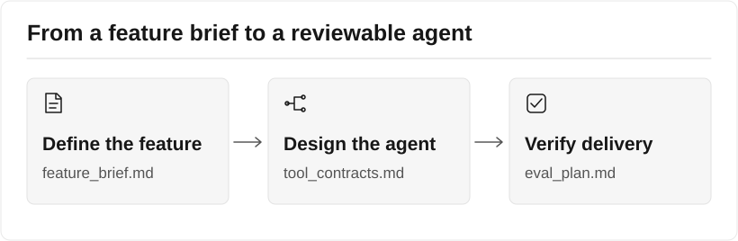

# Agent Fullcycle Engineering

[简体中文](README.md) · [English](README.en.md)

An engineering skill for AI coding assistants. Use it to turn a requirement into an acceptance test, define tool contracts, design evaluations for a CrewAI Crew or Flow, and diagnose failures before release.



- **Use the skill.** Copy the entire [agent-fullcycle-engineering directory](crewskills/skills/agent-fullcycle-engineering/) into your client’s skills directory. Try “Use `$agent-fullcycle-engineering` to write a feature brief and acceptance cases for a customer-support assistant.”
- **Pick a reference.** The [beginner guide](crewskills/skills/agent-fullcycle-engineering/references/beginner-agent-engineer-guide.md) covers the basics, [CrewAI patterns](crewskills/skills/agent-fullcycle-engineering/references/crewai-patterns.md) covers roles and flows, and the [debugging playbook](crewskills/skills/agent-fullcycle-engineering/references/debugging-playbook.md) helps locate failures.
- **Generate planning documents.** Run the command below from the repository root to write the templates to `demo-agent/`. Your project supplies the runtime.

```sh
python3 crewskills/skills/agent-fullcycle-engineering/scripts/scaffold_agent_project.py --name demo-agent --output .
```

[Skill instructions](crewskills/skills/agent-fullcycle-engineering/SKILL.md) · [MIT license](LICENSE)
