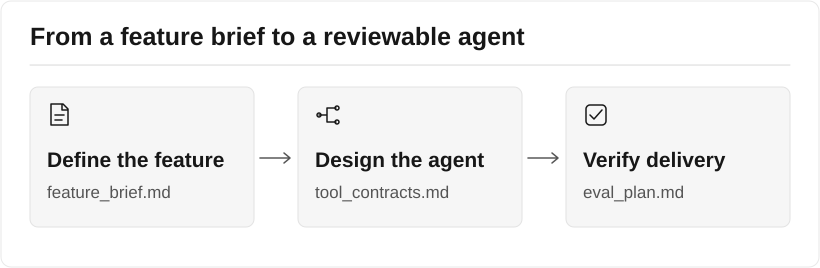

# Agent 全周期工程

[简体中文](README.md) · [English](README.en.md)

一个面向 AI 编程助手的工程技能。它帮助团队把需求写成可验收的功能，明确工具契约，为 CrewAI Crew 或 Flow 设计评测、排查故障并交付。



- **开始使用**　把 [agent-fullcycle-engineering](crewskills/skills/agent-fullcycle-engineering/) 整个目录放入客户端的技能目录，然后按名称调用。示例：“用 `$agent-fullcycle-engineering` 为客服助手写一份功能说明和验收用例。”
- **选择参考**　[入门指南](crewskills/skills/agent-fullcycle-engineering/references/beginner-agent-engineer-guide.md)讲基本概念，[CrewAI 模式](crewskills/skills/agent-fullcycle-engineering/references/crewai-patterns.md)讲角色与流程，[调试手册](crewskills/skills/agent-fullcycle-engineering/references/debugging-playbook.md)讲故障定位。
- **生成规划文档**　在仓库根目录运行以下命令，模板会写入 `demo-agent/`。Agent 的运行逻辑由项目实现。

```sh
python3 crewskills/skills/agent-fullcycle-engineering/scripts/scaffold_agent_project.py --name demo-agent --output .
```

[技能入口](crewskills/skills/agent-fullcycle-engineering/SKILL.md) · [MIT 许可证](LICENSE)
